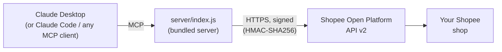

<div align="center">


# Shopee - OtterBridge

**Let your AI assistant run your Shopee shop: list products in bulk, change prices by rule, ship the day's orders, handle returns and read the numbers, in plain English.**

[](https://github.com/wen-da-ng/otterbridge-shopee-mcp/releases/latest)
[](LICENSE)
[](https://modelcontextprotocol.io)
[](https://open.shopee.com/developer-guide/4)
[](#install--claude-desktop)
[](#install--claude-code-plugin)

[Before you start](#before-you-start--your-shopee-developer-app) ·
[Install](#install--claude-desktop) ·
[How it works](#how-it-works) ·
[Tools](#what-your-ai-can-do) ·
[Safety](#safety--security) ·
[What's in this repo](#whats-in-this-repo)

</div>

> **Official API, your own app.** This uses Shopee's official
> [Open Platform API v2](https://open.shopee.com/developer-guide/4) with a developer app
> **you** register (free), so it talks to Shopee the way ERP and inventory software does,
> not by scraping Seller Centre. It is not affiliated with or endorsed by Shopee.

## How it works

One bundled Node server signs every request with your app's Partner Key and calls Shopee
for the shop you authorized.



Your assistant can create listings from spreadsheet rows, change prices and stock for
hundreds of SKUs with one rule, ship the day's orders and save the airway bills, answer
returns, and report on sales, fees and profit. Anything else in Shopee's API (vouchers,
discounts, flash sales, bundle deals, ads, ...) is reachable through a bundled catalogue of
all **454** v2 endpoints.

**Nothing changes your shop without your OK.** Every tool that would change something
only returns a preview and a `plan_id`; one tool, `shopee_apply_plan`, carries it out
after you approve. See [How changes work](#how-changes-work-preview-then-apply).

Everything runs **on your computer**. Your Partner Key and shop tokens never leave it,
except as signatures on requests to Shopee.

## Before you start — your Shopee developer app

Each seller uses **their own** Shopee developer app. It's free and takes a few minutes,
plus Shopee's review before you can use your real shop.

1. Sign up at [open.shopee.com](https://open.shopee.com) with your seller account and
   complete the developer registration.
2. Go to [Console → App List](https://open.shopee.com/console/app) → **Create App**, and
   pick the **Seller In House System** category (an app for your own shop).
3. On the app page, copy the **Test Partner_id** and the **Test API Partner Key** (click
   the eye icon). Test credentials only work in the **sandbox**.
4. Under **Test Account-Sandbox v2**, create a test shop (**Local Shop**, then your
   market). Note its login; you use it to authorize in the sandbox.
5. When you're ready for your real shop, click **Go-Live** on the app and complete
   Shopee's review. The **Live** Partner ID and Key then appear; they only work in
   **production**.

Leave the app's **Redirect URL Domain** empty. Shopee then accepts the localhost address
this server listens on, and authorization completes by itself. (If you do set a domain,
see Troubleshooting below.)

## Install — Claude Desktop

You need **Claude Desktop** and the Partner ID and Key from above. No Node.js, no git, no
terminal: Claude Desktop runs the server itself.

**1 — Download [`otterbridge-shopee-mcp.mcpb`](https://github.com/wen-da-ng/otterbridge-shopee-mcp/releases/latest)**
from the latest release (or from this repo).

**2 — Install it** from Claude Desktop: **Settings → Extensions → Advanced settings →
Install Extension…**, then pick the `.mcpb` file. (Double-clicking the file also works
where Claude Desktop has claimed the `.mcpb` file type; on Windows it often hasn't, so use
the menu.)

**3 — Fill in the settings** it asks for:

| Setting | What to put |
|---|---|
| **Partner ID** / **Partner Key** | From your app page. Test ones for the sandbox, Live ones for production. The key is kept in your system's secure storage. |
| **Environment** | `sandbox` to try it on your test shop, `production` for your real shop. |
| Everything else | Leave the defaults. See [Options](#options). |

**4 — Connect your shop — just ask Claude.** Say *"connect my Shopee shop"*. Claude gives
you a link; open it, log in as the seller (in the sandbox, the test shop from step 4
above) and confirm. Shopee sends you back to a local page that says it worked, and Claude
carries on.

**5 — Try it:** *"How many orders are waiting to ship?"* or *"Give me a sales report for
last month."*

<details>
<summary><b>Troubleshooting</b></summary>

**Ask Claude to run `shopee_auth_status` first.** It says what's configured, which shops
are connected and when their authorization expires.

- **"Shopee credentials are not configured"** — the Partner ID or Key is empty. Fill them
  in under Settings → Extensions → Shopee - OtterBridge.
- **`error_sign` / "wrong sign"** — the Partner Key doesn't match the Partner ID, or Test
  credentials are being used with `production` (or Live ones with `sandbox`). Also check
  your computer's clock: Shopee rejects requests more than 5 minutes off.
- **"shop is not authorized" / token errors** — ask Claude to connect the shop again.
  Access refreshes by itself every 4 hours, but if the server isn't used for **30 days**
  the refresh token expires and you authorize again. A seller's authorization itself lasts
  up to 365 days.
- **The link opens but nothing comes back** — something else is using port 8787, or you
  set a Redirect URL Domain on the app. Copy the `code` from the address bar of the page
  Shopee sent you to and tell Claude *"complete the authorization with code …"*
  (`shopee_auth_complete`).
- **New products don't show up yet** — in the **sandbox**, Shopee takes a few hours to
  list newly created products, and price changes on them can fail with "please try later"
  in that window. Re-running an import is safe: SKUs already in the shop are skipped.
- **A Shopee warning that results "might be outdated"** — during big campaigns Shopee runs
  its order search in a reduced mode and says so. The tools pass that warning on; re-run
  the report later for exact totals.
</details>

## Install — Claude Code (plugin)

From a local copy of this repo, a clone or a folder someone handed you:

```
/plugin marketplace add C:\path\to\otterbridge-shopee-mcp
/plugin install otterbridge-shopee-mcp@otterbridge
```

Or straight from git, if you have access to the repo:

```
/plugin marketplace add wen-da-ng/otterbridge-shopee-mcp
/plugin install otterbridge-shopee-mcp@otterbridge
```

`marketplace add` is not a submission to any public directory: it points Claude Code at a
folder or repo holding `.claude-plugin/marketplace.json`. `otterbridge` is the marketplace
name declared in that file.

**Then put your credentials in `~/.shopee-mcp/.env`** (`%USERPROFILE%\.shopee-mcp\.env` on
Windows). The server reads it at start-up; nothing in the plugin folder needs editing:

```ini
SHOPEE_PARTNER_ID=1234567
SHOPEE_PARTNER_KEY=your-partner-key
SHOPEE_ENV=sandbox
```

Run `/mcp` to reconnect `shopee`, then ask Claude to *"connect my Shopee shop"*.

## Install — any other MCP client

Clone this repo and point the client at the bundled server. It is a plain stdio MCP server
with no install step and no dependencies; it needs **Node.js 20.12+**.

```json
{
  "mcpServers": {
    "shopee": {
      "command": "node",
      "args": ["C:/path/to/otterbridge-shopee-mcp/server/index.js"],
      "env": {
        "SHOPEE_PARTNER_ID": "1234567",
        "SHOPEE_PARTNER_KEY": "your-partner-key",
        "SHOPEE_ENV": "sandbox"
      }
    }
  }
}
```

Or leave `env` out and use `~/.shopee-mcp/.env` as above. Env set by the client wins over
the file.

## What your AI can do

**32 tools and 3 ready-made prompts.** Everything returns compact JSON.

| Area | What it covers |
|---|---|
| **Products** | Bulk create from rows (variations, images, category and attributes by name), export, price / stock / details / status changes by rows or by rule, delete, variations, reviews and replies, boosts |
| **Orders & shipping** | Orders for any date range, ship everything waiting (pickup or drop-off chosen for you), airway bill PDFs per courier |
| **Returns** | Return and refund requests with deadlines, then accept, offer a partial refund, accept the buyer's counter-offer, or dispute with evidence |
| **Reports** | Catalogue and stock, sales, payouts and fees (with profit when you give unit costs), shop health, listing quality |
| **Everything else** | Search, read and call any of the 454 Shopee Open API v2 endpoints, with signing, parameter checks and uploads handled |

Ask in plain English: *"Raise every T-shirt by RM2 and make the prices end in .90"*,
*"List these 40 rows from my sheet as new products"*, *"Ship today's orders and save the
labels"*, *"What did I actually earn in October after fees?"*

<details>
<summary><b>Setup and plans (6)</b></summary>

| Tool | Does |
|---|---|
| `shopee_auth_start` / `shopee_auth_complete` | Connect a shop: the redirect back to this computer is caught automatically, or paste the code. |
| `shopee_auth_status` | What's configured, every connected shop (name, region, expiry). |
| `shopee_set_default_shop` | The shop used when a request doesn't name one. |
| `shopee_apply_plan` | **Carries out a plan.** The only tool that changes your shop. |
| `shopee_list_plans` | Plans waiting for approval; discard one. |
</details>

<details>
<summary><b>Products (12)</b></summary>

| Tool | Does |
|---|---|
| `shopee_products_export` | One row per SKU with the fields you choose: price, stock, status, description, images, weight, stats and more. Filter by ids, SKUs, SKU prefix, name, category, status, stock or price range. Paged. Good for lookups or filling a spreadsheet. |
| `shopee_products_update` | Plan changes to price, stock, live/unlisted, name, description, images, weight, package size, condition, pre-order or SKU. Takes `rows` (by SKU or ids) or a `rule` (filter + `set`/`adjust`: percent, amount, rounding, forced price endings, stock delta). The preview checks category limits. |
| `shopee_products_delete` | Plan a permanent delete by item id or SKU. |
| `shopee_products_import` | Create many products from rows: one row per SKU, rows sharing a `parent_sku` become one product with up to 2 variation tiers. Category, attributes and brand go **by name** (`{"Material": "Cotton"}`) and are matched to Shopee's ids. The preview checks every product against its category's rules and lists problems by row. Created ids come back per row, to write back to the sheet; SKUs already in the shop are skipped, so re-running a sheet is safe. |
| `shopee_find_category` / `shopee_get_category_requirements` | Find a category, then its mandatory attributes, allowed values, brands and limits. |
| `shopee_set_variations` | Plan adding up to 2 variation tiers to an existing product. |
| `shopee_upload_images` | Upload images from your computer or a URL and get Shopee image ids. |
| `shopee_list_logistics_channels` | Your shipping channels. |
| `shopee_reviews_list` / `shopee_reviews_reply` | Reviews with a rating summary, filtered to unreplied or low-rated; replies go through a plan. |
| `shopee_boost_items` | List boosted products, or plan a boost of up to 5. |
</details>

<details>
<summary><b>Orders, shipping and returns (5)</b></summary>

| Tool | Does |
|---|---|
| `shopee_orders_list` | Orders for any date range as compact rows, with counts by status. Filter by status, e.g. `READY_TO_SHIP`. `item_lines` adds per-SKU lines. |
| `shopee_ship_orders` | Plans shipment for every order waiting to ship, or the ones you list. Picks pickup (default address, earliest slot) or drop-off per package, and lists the orders it can't ship and why. |
| `shopee_shipping_labels` | Creates the airway bills, waits for Shopee to generate them, and saves PDFs (one per courier and label type) to your **Save files to** folder. |
| `shopee_returns_list` | Return and refund requests: reason, buyer's note, amount, respond-by date, and those due within 48 hours. With `return_sns`, also the solutions you can offer and the evidence Shopee accepts for a dispute. |
| `shopee_return_action` | Plans a response: accept, offer refund-only or return-and-refund with an amount, accept the buyer's counter-offer, or dispute with evidence images. The preview shows the money impact. |
</details>

<details>
<summary><b>Reports, read-only (5)</b></summary>

| Tool | Gives you |
|---|---|
| `shopee_catalog_report` | Products and SKUs by status, stock units and value, out-of-stock and low-stock items, best sellers and most viewed, products with views but no sales, low ratings, thin listings. |
| `shopee_sales_report` | Any date range: orders, units, GMV, average order value, status mix, cancellations and reasons, unique and repeat buyers, daily trend, top products. |
| `shopee_finance_report` | Settled orders: payouts, gross, every Shopee fee, shipping, your discounts and vouchers, refunds, net income and fee rate. `unit_costs` adds cost of goods and gross profit. |
| `shopee_shop_health` | Overall rating, failing metrics, listings with issues, late orders, penalty points. |
| `shopee_listing_quality` | Shopee's content diagnosis and suggested fixes for each listing. |
</details>

<details>
<summary><b>Every other endpoint (4)</b></summary>

| Tool | Does |
|---|---|
| `shopee_search_api` / `shopee_describe_api` | Search the bundled catalogue of all 454 v2 endpoints; read any endpoint's parameters, response and an example call. |
| `shopee_api_read` | Call any endpoint that only reads. Runs straight away. |
| `shopee_api_write` | Plan a call to any endpoint that changes something: vouchers, discounts, flash sales, bundle deals, ads, .... `files` handles uploads. |

Path, method, signing, array formatting and required-parameter checks come from the
catalogue. Endpoints for other app types are refused with an explanation. The full list
is in [docs/API_CATALOG.md](docs/API_CATALOG.md).
</details>

<details>
<summary><b>Prompts (3)</b></summary>

Ready-made workflows: **`shopee_daily_briefing`** (yesterday's sales, orders to ship, low
stock, reviews to answer, shop health), **`shopee_new_listing`** (rows → checked preview →
create) and **`shopee_pricing_review`** (prices against sales and margins, then a planned
change). In Claude Code they appear as slash commands.
</details>

### How changes work: preview, then apply

Tools that change your shop **never change it directly**. They return a short preview
(counts, a sample of before → after values, rows that couldn't be matched, warnings) and a
`plan_id`. The change happens only when `shopee_apply_plan` is called with that id, which
your assistant is told to do only after you approve. Plans run once and expire after 30
minutes.

- **One approval point.** In your MCP client you can let every tool run freely except
  `shopee_apply_plan`.
- **Bulk-friendly.** A 2,000-SKU price change is previewed once and applied by id; the
  rows aren't sent twice. Failures are reported per row, and the rest still go through.
- **Rules or rows.** Give a rule (a filter plus `set` / `adjust`) and the server finds the
  SKUs, or give rows, e.g. read from Google Sheets by its own connector.

Every tool also declares what it does using the MCP standard for it (`ToolAnnotations`):

| | Count | What it means |
|---|---|---|
| 🟢 **Read-only** | 16 | Looks and changes nothing: reports, lists, exports, lookups. |
| 🟡 **Builds a plan** | 9 | Returns a preview and a `plan_id`; changes nothing yet. |
| 🔴 **Applies** | 1 | `shopee_apply_plan`. The one tool to keep behind your approval. |
| ⚪ **Housekeeping** | 6 | Connecting shops, choosing the default shop, discarding plans, uploading images to Shopee's image space, and generating airway bills for orders already shipped. |

## Safety & security

- **Your Partner Key is a credential.** With it and a connected shop, anyone can act on
  that shop through the API. Claude Desktop keeps it in your system's secure storage; in a
  `.env` file, keep the file private and out of git, shared drives and screenshots.
- **Shop tokens stay on your computer**, in `~/.shopee-mcp/` (one file per environment and
  Partner ID). They are saved straight away on every refresh, because Shopee's refresh
  tokens work only once. Deleting that folder disconnects this computer; cancelling the
  authorization on Shopee's side ends it everywhere.
- **Changes are previewed, then applied** — see above. Turn on **Read-only** in the
  settings (`SHOPEE_READ_ONLY=true`) and the tools that apply changes are not loaded at
  all.
- **Start in the sandbox.** Test credentials only reach test shops, so you can try bulk
  edits with nothing at stake.
- **Local only.** The only network traffic is HTTPS to Shopee's API hosts, plus a
  listener on `localhost:8787` that's open only while you authorize a shop.
- **One readable file.** The server ships as a single bundled `server/index.js`, not
  minified, with no install step and no `node_modules`, so no third-party install scripts
  run and the whole thing can be read.
- **Your assistant still decides what to plan.** The preview is the safeguard: read it.
  Prompt injection from untrusted text (a buyer's message, a product description) is the
  main residual risk, which is why applying needs your OK.

## Options

In Claude Desktop these are the extension's settings. For other clients set the
environment variable, or put it in `~/.shopee-mcp/.env`.

| Setting / env | Default | Effect |
|---|---|---|
| Partner ID / `SHOPEE_PARTNER_ID` | (required) | From your app page. |
| Partner Key / `SHOPEE_PARTNER_KEY` | (required) | From your app page. |
| Environment / `SHOPEE_ENV` | `sandbox` | `sandbox` or `production`. Each has its own token file. |
| API region / `SHOPEE_REGION` | `global` | `global`, `cn` (servers in mainland China) or `br` (Brazil). |
| Redirect URL / `SHOPEE_REDIRECT_URI` | `http://localhost:8787/callback` | Where Shopee sends you after authorizing. |
| Default shop ID / `SHOPEE_SHOP_ID` | (first connected) | For several shops: the one used when none is named. |
| Read-only / `SHOPEE_READ_ONLY` | `false` | `true` leaves out `shopee_apply_plan` and most planning tools (24 tools remain), so nothing can be changed. |
| Tool groups / `SHOPEE_TOOLSETS` | all | `core` is always on; add `catalog`, `insights`. E.g. `core,insights` for orders and reports only. |
| Save files to / `SHOPEE_EXPORT_DIR` | `~/shopee-mcp-exports` | Where airway bills and other files go. |
| Time zone offset / `SHOPEE_TZ_OFFSET_HOURS` | `8` | Groups reports by day: 8 for MY, SG, PH, TW; 7 for TH, VN, ID; -3 for BR. |
| `SHOPEE_TOKEN_FILE` | `~/.shopee-mcp/tokens.<env>.<partner_id>.json` | Where shop tokens are kept. |
| `SHOPEE_ENV_FILE` | `~/.shopee-mcp/.env` | Read a different `.env` file. |

## Going live

1. In the [console](https://open.shopee.com/console/app), click **Go-Live** on the app and
   complete Shopee's review.
2. Change **Environment** to `production` and enter the **Live** Partner ID and Key.
3. Connect your real shop (*"connect my Shopee shop"*). Production tokens go into their
   own file, so your sandbox connection stays as it was.

## Known limitations

- **Shipping, airway bills and returns are not yet tested end to end.** Shopee's sandbox
  can't create test orders for Malaysian test shops at the moment (reported to Shopee), and
  returns aren't supported in the sandbox at all. The tools are built to Shopee's docs and
  covered by unit tests; try them on a few orders first, and read the preview.
- **New sandbox products take hours to appear** in Shopee's product lists; reports and
  rule-based edits don't see them until then.
- `category_recommend` and `get_shop_performance` return errors in the sandbox; the tools
  fall back (keyword category search) or report the error and carry on.
- Ads and livestream have no dedicated tools; use `shopee_search_api` → `shopee_api_read`
  / `shopee_api_write`.

## What's in this repo

This is the **distribution** repo: built files only.

```
server/index.js                 the bundled MCP server (esbuild, not minified)
server/data/api-registry.json   the catalogue of all 454 Shopee v2 endpoints
otterbridge-shopee-mcp.mcpb     the Claude Desktop extension bundle
manifest.json                   MCPB manifest the .mcpb is built from
.claude-plugin/                 Claude Code plugin + marketplace manifests
.mcp.json                       Claude Code plugin server wiring
docs/API_CATALOG.md             every endpoint, what this app type can call, links to Shopee's docs
CHANGELOG.md                    what changed in each release
NOTICE                          third-party attribution
static/                         icons
```

Everything here is produced by the build in a private source repo and copied in whole, so
there is nothing to patch by hand: a fix goes into the source and comes back out as a new
build.

## Roadmap

- [x] Signing, seller authorization, token refresh, several shops
- [x] Products: bulk import from rows, export, rule-based edits, variations, reviews, boosts
- [x] Orders, shipping and airway bills (Shopee's new job-based label flow, with fallback)
- [x] Returns and refunds
- [x] Sales, finance, catalogue, shop health and listing quality reports
- [x] Every v2 endpoint through the bundled catalogue
- [x] One-click Claude Desktop extension and Claude Code plugin
- [ ] Shipping, labels and returns verified end to end on live orders
- [ ] Hosted option for sellers without their own developer app

## Licence

GPL-3.0. See [LICENSE](LICENSE). Third-party attribution in [NOTICE](NOTICE).

Not affiliated with, endorsed by, or sponsored by Shopee or Sea Limited. Shopee is a
trademark of Shopee Pte. Ltd.

---

<div align="center">

_Built by <b>wen-da-ng</b> · OtterBridge_

</div>
